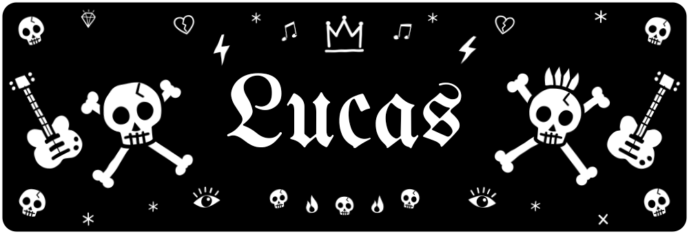
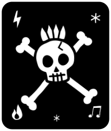
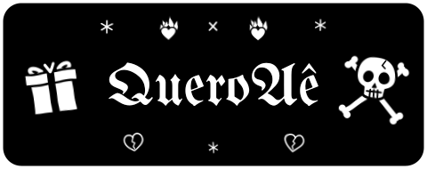
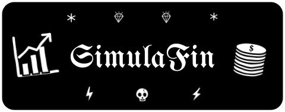
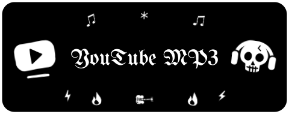
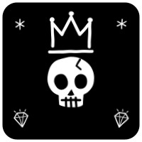
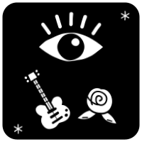

  

  

<h2 align="center"> 👋 Olá! Eu sou o Lucas </h2>

🎓 Estudante de Análise e Desenvolvimento de Sistemas 
💻 Desenvolvedor em formação, apaixonado por tecnologia, programação e por criar soluções digitais que facilitam o dia a dia 
📍 São Paulo - SP, Brasil

##  🚀 Sobre mim

Desde criança sempre fui muito conectado com a tecnologia: mexia muito nas redes sociais, jogava muitos joguinhos, assistia muitos vídeos no YouTube e vivia fuçando a internet. Junto com isso, meus pais sempre me aconselharam a estudar para fazer algo que não exigisse tanto fisicamente. Eu via de perto o quão difícil é esse tipo de trabalho e sempre valorizei quem faz, mas sabia que não era pra mim. Foi em ADS que encontrei o caminho que juntava essas duas vontades.

Gosto de entender os processos como um todo, não só a parte pela qual sou responsável. Nos trabalhos em grupo, sempre assumo a organização das tarefas, ajudo a equipe e defino o que cada um pode fazer. Foi assim que percebi que gosto de transformar ideias em um plano de execução.

Tenho experiência e interesse em Python, React, JavaScript, MySQL e Power BI, buscando sempre transformar ideias em projetos reais e aprender novas tecnologias durante o processo.

Também tenho uma mentalidade resolutiva, que ADS só fez crescer. Um exemplo: meu tio queria levar as músicas de rock e metal que ele gosta no cartão de memória para ouvir no carro durante uma viagem, mas não sabia como. Percebi que dava para resolver isso com programação e desenvolvi um [programa em Python com interface gráfica](https://github.com/Nabucoo/YoutubeDownloaderMP3) que converte links do YouTube em .MP3. Foi muito legal ver algo que eu construí atender a necessidade real de uma pessoa.

##  🛠️ Tecnologias e Ferramentas

         

##  📂 Projetos em destaque

Alguns dos projetos que desenvolvi, colocando em prática o que venho aprendendo:

<table>
<tr>
<td width="50%" valign="top">

🎁 **QueroAê**

Plataforma de listas de presentes para grupos de família e amigos. Cada pessoa monta a lista do que gostaria de ganhar e os outros marcam o que vão comprar, sem que o dono da lista saiba quem escolheu o quê. Assim você ganha o que queria e a surpresa continua garantida.

   

🔗 [Acessar o site](https://queroae.vercel.app) · 📁 [Repositório](https://github.com/Nabucoo/Queroae)

</td>
<td width="50%" valign="top">

📈 **SimulaFin**

Projeto em Java com dois programas: um gerador de transações financeiras sintéticas em CSV e um processador que calcula análises sobre esses arquivos, em modo sequencial ou paralelo. Os dados são artificiais e servem para desenvolvimento, demonstrações e testes de desempenho.

  

📁 [Repositório](https://github.com/Nabucoo/SimulaFin)

</td>
</tr>
<tr>
<td width="50%" valign="top">

🎵 **YouTube Downloader MP3**

Programa em Python com interface gráfica que pega links do YouTube e converte em arquivos .MP3. Criei para ajudar meu tio a levar as músicas de rock e metal que ele gosta no cartão de memória para ouvir no carro.

  

📁 [Repositório](https://github.com/Nabucoo/YoutubeDownloaderMP3)

</td>
<td width="50%" valign="top"></td>
</tr>
</table>

##  🎯 Objetivo

Meu objetivo é conquistar uma oportunidade de estágio na área de tecnologia, onde eu possa aplicar meus conhecimentos em projetos reais, desenvolver novas habilidades e aprender com profissionais da área.

Busco crescer constantemente como desenvolvedor, contribuindo com a equipe e transformando cada desafio em uma oportunidade de aprendizado.

##  📚 Atualmente estudando

🐍 Desenvolvimento de aplicações com Python 
⚛️ Desenvolvimento de interfaces com React 
🔙 Conceitos de Back-end e APIs 
🗄️ Banco de dados e MySQL 
📊 Análise e visualização de dados com Power BI 
🔧 Boas práticas de desenvolvimento e Git/GitHub

##  📫 Entre em contato

📧 E-mail: lucashasfj2006@gmail.com

<i>⭐ Sempre aprendendo, desenvolvendo e buscando evoluir um pouco mais a cada projeto.</i>

