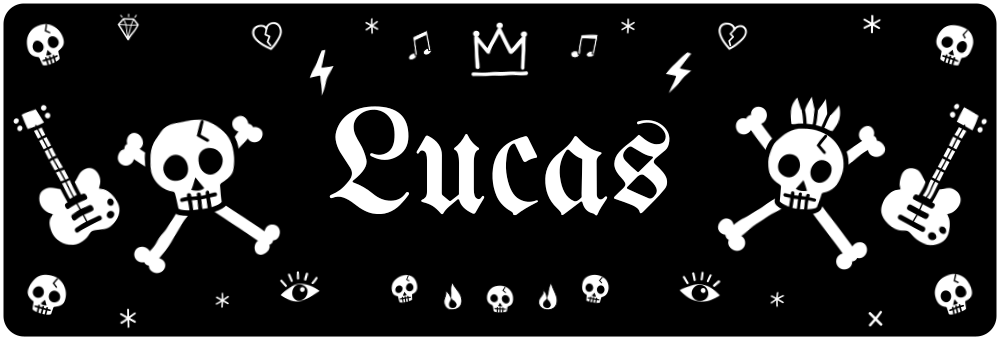
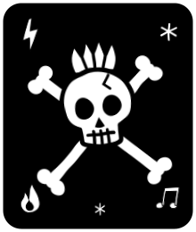
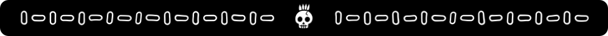
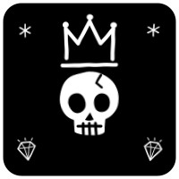
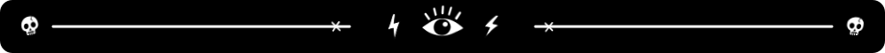
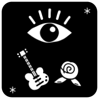
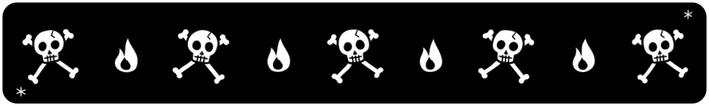

  

  

<h2 align="center"> 👋 Olá! Eu sou o Lucas </h2>

🎓 Estudante de Análise e Desenvolvimento de Sistemas 
💻 Desenvolvedor em formação, apaixonado por tecnologia, programação e por criar soluções digitais que facilitam o dia a dia 
📍 São Paulo - SP, Brasil

##  🚀 Sobre mim

Sou estudante de Análise e Desenvolvimento de Sistemas, atualmente focado em aprimorar minhas habilidades como desenvolvedor e construir uma base sólida em tecnologia. Sou apaixonado por criar soluções digitais que facilitam o dia a dia das pessoas através de códigos limpos e funcionais.

Tenho experiência e interesse em Python, React, JavaScript, MySQL e Power BI, buscando sempre transformar ideias em projetos reais e aprender novas tecnologias durante o processo.

Gosto de desafios que envolvem lógica, resolução de problemas e criatividade. Atualmente, venho aprofundando meus conhecimentos tanto em Front-end quanto em Back-end, buscando compreender cada vez melhor como as aplicações são desenvolvidas e integradas.

##  🛠️ Tecnologias e Ferramentas

         

##  🎯 Objetivo

Meu objetivo é conquistar uma oportunidade de estágio na área de tecnologia, onde eu possa aplicar meus conhecimentos em projetos reais, desenvolver novas habilidades e aprender com profissionais da área.

Busco crescer constantemente como desenvolvedor, contribuindo com a equipe e transformando cada desafio em uma oportunidade de aprendizado.

##  📚 Atualmente estudando

🐍 Desenvolvimento de aplicações com Python 
⚛️ Desenvolvimento de interfaces com React 
🔙 Conceitos de Back-end e APIs 
🗄️ Banco de dados e MySQL 
📊 Análise e visualização de dados com Power BI 
🔧 Boas práticas de desenvolvimento e Git/GitHub

##  📫 Entre em contato

📧 E-mail: lucashasfj2006@gmail.com

<i>⭐ Sempre aprendendo, desenvolvendo e buscando evoluir um pouco mais a cada projeto.</i>

